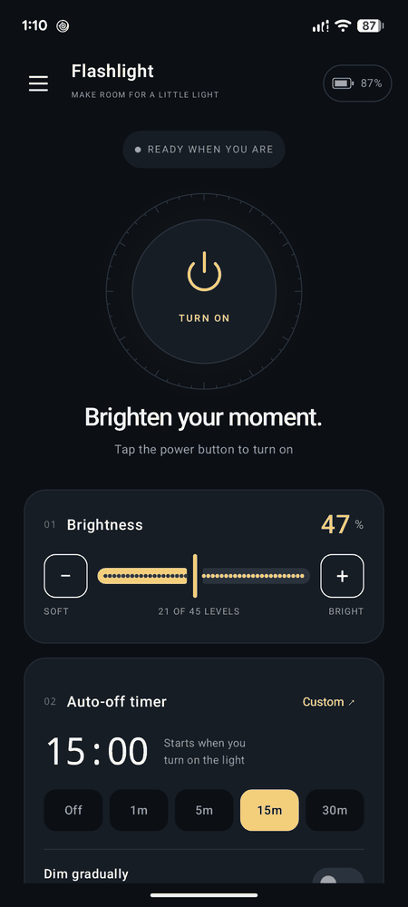

# Little Lamp CMP

Little Lamp is an Android app for using your phone's flashlight or screen as a light, with optional ambient sound.



## Features

- Control the flashlight with timers, gradual dimming, and repeating on/off rhythms. Brightness adjustment depends on device support.
- Use the screen as a solid color light, gradient, or multiple color zones. Save lighting presets.
- Browse ambient sounds, download them for looping playback, or add audio from your device. Sound can play on its own or alongside a light.
- Control active sessions from Android notifications.

## Get the Android app

Download the APK from the [latest GitHub release](https://github.com/zakaria5729/Little-Lamp-CMP/releases/latest). The current APK is debug signed because release signing is not configured. Android 7.0 (API 24) or newer is required.

## Build from source

Install JDK 17 and an Android SDK with API 37, then run:

```sh
./gradlew :androidApp:assembleDebug
```

The APK is written to `androidApp/build/outputs/apk/debug/androidApp-debug.apk`.

To run the shared module tests:

```sh
./gradlew :composeApp:allTests
```

The `composeApp` module contains the Compose UI and shared app logic. The `androidApp` module contains the Android entry point, services, notifications, and device integrations. GitHub releases currently publish Android APKs only.
